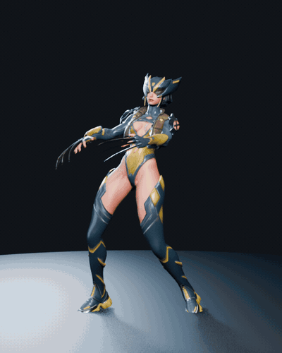
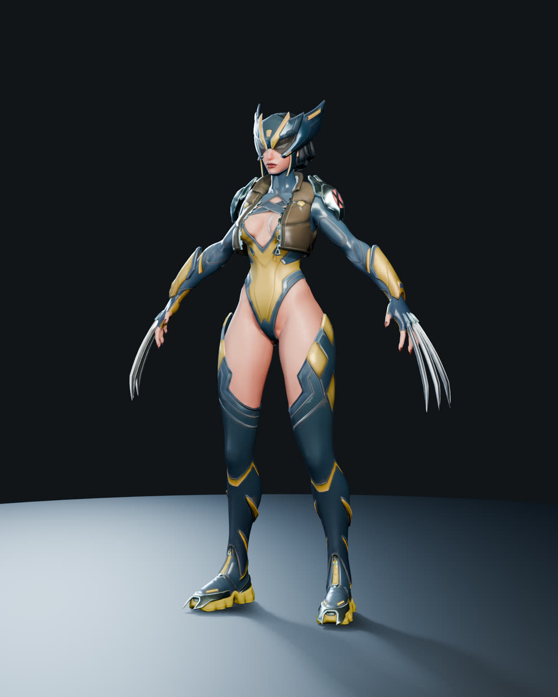
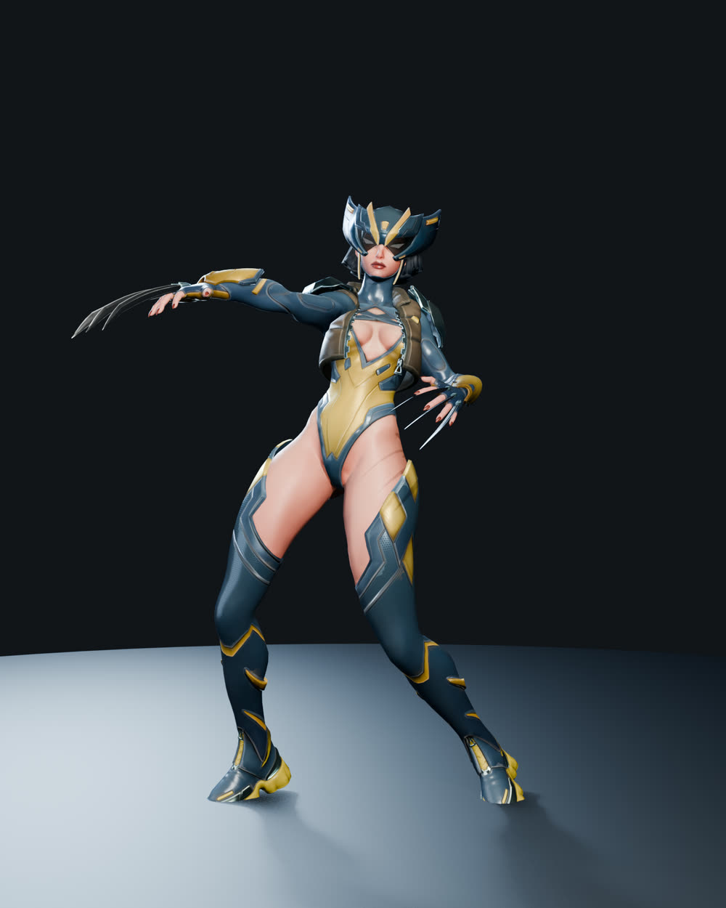
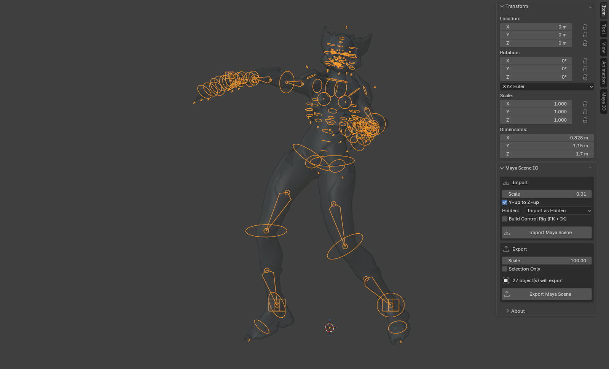
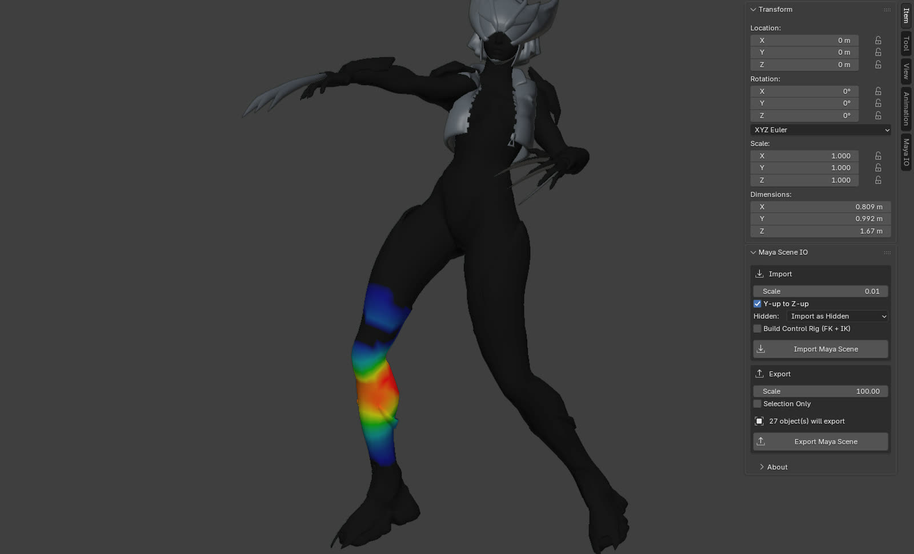
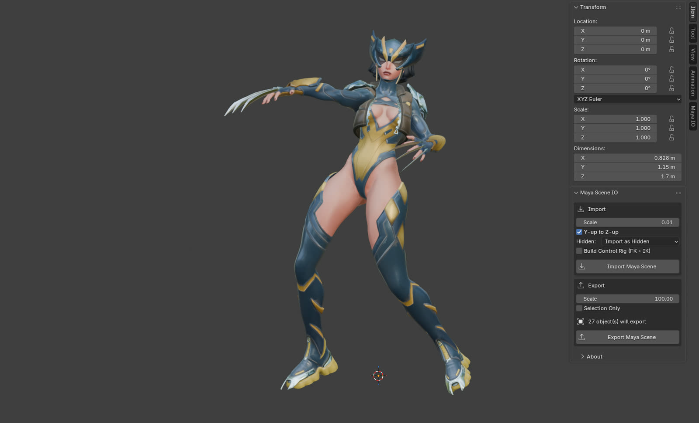

<h1 align="center">Maya Scene IO</h1>

<p align="center">
  
</p>

<p align="center">
  Bring Maya scenes into Blender, and back out again. Reads <code>.ma</code> and <code>.mb</code> with no Maya installed.
</p>

<p align="center">
  <a href="https://github.com/MenuuTUX/maya-scene-io/releases"></a>
  
  
  
  <a href="https://github.com/MenuuTUX/maya-scene-io"></a>
</p>

<p align="center">
  <a href="#demo">Demo</a> ·
  <a href="#install">Install</a> ·
  <a href="#quick-start">Quick start</a> ·
  <a href="#features">Features</a> ·
  <a href="#two-engines">Engines</a> ·
  <a href="#troubleshooting">Troubleshooting</a> ·
  <a href="#credits">Credits</a>
</p>

---

## Demo

One `.ma` file in, a textured and skinned character out. The scene below is a Maya Advanced Skeleton rig
(see [Credits](#credits)). It imported in under a second with the native engine, no Maya involved.

<p align="center">
  
</p>
<p align="center"><sub>Posed in Blender through the control rig the add-on generates. The animation is mine; the source file has no time-based keys.</sub></p>

<table>
  <tr>
    <td width="50%" align="center">
      
      <br><sub><b>Straight off the import.</b> Geometry, UVs and PBR textures wired into Principled BSDF.</sub>
    </td>
    <td width="50%" align="center">
      
      <br><sub><b>Posed.</b> The skeleton and skin weights carry over, so the mesh deforms as it did in Maya.</sub>
    </td>
  </tr>
  <tr>
    <td width="50%" align="center">
      
      <br><sub><b>Generated control rig.</b> 121 FK control shapes and 4 IK limbs, built from the file.</sub>
    </td>
    <td width="50%" align="center">
      
      <br><sub><b>Skin weights.</b> Each Maya skinCluster becomes vertex groups plus an Armature modifier.</sub>
    </td>
  </tr>
</table>

What the importer found in that one file: 24 meshes, 586 bones, 17 skinned meshes, 12 materials and 8
shape keys. Body, hair and helmet textures were matched to their materials by filename. Hidden helper
meshes went into their own collection instead of cluttering the scene.

## Install

Works the same on Windows, macOS and Linux. You need Blender 4.2 or newer.

1. Download `maya_scene_importer-x.y.z.zip` from the [Releases page](https://github.com/MenuuTUX/maya-scene-io/releases). Do not unzip it. Blender installs the zip as-is.
2. In Blender open `Edit > Preferences > Get Extensions`, click the small drop-down arrow at the top right, choose `Install from Disk...`, and pick the zip.
3. Confirm **Install and Enable** when Blender asks. To enable it later, find Maya Scene IO under `Edit > Preferences > Get Extensions > Installed`.

<details>
<summary>Upgrading from loose .py files?</summary>

If you copied the individual `.py` files into Blender's `scripts/addons` folder, remove those copies
and restart Blender. The files belong together inside the extension zip. Blender can mistake loose
support files for separate add-ons and warn that they are missing `bl_info`.

</details>

## Quick start

1. `File > Import > Maya Scene`, pick a `.ma` or `.mb`.
2. Leave the engine on `Auto`. Tick `Build Control Rig (FK + IK)` if you want something to pose right away.
3. Export with `File > Export > Maya Scene`.

There is also a `Maya IO` tab in the 3D viewport sidebar (press `N`) with the same options and
one-click buttons.

<p align="center">
  
</p>

## Features

| | Import | Export |
| --- | --- | --- |
| Meshes | Vertices, polygons, all UV sets, vertex colours, edge hardness, per-face materials | Placed in world space, with UVs, normals, vertex colours, per-face materials and visibility |
| Materials | Principled BSDF, with PBR textures sitting next to the file wired up automatically | Per-face material assignment |
| Skeleton | Joint hierarchy at bind pose, deform bones split into their own bone collection | Skeleton with its hierarchy |
| Skin | Weights as vertex groups plus an Armature modifier | Skin weights |
| Shapes | Blend shapes as shape keys | Blend shapes with their weights |
| Scene | Cameras, lights, time-based animation, Maya visibility sorted into collections | |
| Rig | Optional FK + IK control rig generated from the file | |

Both engines bring over geometry, UVs, the skeleton at its bind pose, skin weights and blend shapes.
Only the native engine rebuilds materials as Principled BSDF and wires up PBR textures.

### What does not transfer

The logic of a Maya control rig does not come across, in this add-on or any other: FK/IK switches,
set-driven keys, and the utility-node graph that makes controls drive joints. That lives in Maya's
evaluation engine and has no Blender equivalent. You get a clean, skinned deform skeleton and rebuild
the animator rig in Blender.

To get you started, the add-on can generate a basic FK + IK control rig from the file. That is the rig
in the demo above.

## Two engines

Reading any Maya file without Maya is not possible. Files can reference plugin nodes, such as Arnold or
custom rigs, that no outside tool can decode. Some meshes exist only as construction history that Maya
evaluates on load. So you pick an engine per import.

| | Native | Maya bridge |
| --- | --- | --- |
| Needs Maya installed | No | Yes |
| How it works | Parses `.ma` and `.mb` directly in Python | Runs a local `mayapy`, has Maya export the scene to FBX, then Blender imports the FBX |
| Works offline | Yes | Yes |
| Old Maya files | Yes | Yes, any version |
| Plugin nodes and references | No | Yes |
| Construction-history-only meshes | Skipped with a warning | Yes |
| Materials | Lambert, blinn, phong, rebuilt as Principled BSDF | Whatever Maya exports to FBX |
| `.mb` import | Yes, newer than `.ma` support | Yes |
| `.mb` export | No | Yes |

`Auto`, the default, uses Native, except that a `.mb` goes through the bridge when Maya is installed.
If the bridge fails, the add-on falls back to Native. The bridge is the same approach the commercial
Maya importers use.

The native engine is best effort. It handles the standard data on most files, but unusual nodes or
exotic materials may come in partially.

### Setting up the bridge

The bridge, and `.mb` export, need Maya on the same computer. The add-on runs `mayapy`, a Python
interpreter inside Maya's `bin` folder. It never opens Maya's window.

The add-on looks for Maya in the usual places and picks the newest version it finds, so you may not
have to do anything. If the sidebar's "Maya Binary (.mb)" panel says Maya was not found and you want
the bridge, set the path in `Edit > Preferences > Add-ons > Maya Scene IO`. Any of these works:

| OS | `mayapy` is usually at |
| --- | --- |
| Windows | `C:\Program Files\Autodesk\Maya2024\bin\mayapy.exe` |
| macOS | `/Applications/Autodesk/maya2024/Maya.app/Contents/bin/mayapy` |
| Linux | `/usr/autodesk/maya2024/bin/mayapy` |

Picking the `bin` folder or the Maya install folder works as well. The `MAYA_LOCATION` environment
variable is honoured too.

## Troubleshooting

<details>
<summary>"Maya was not found"</summary>

Set the path as described in [Setting up the bridge](#setting-up-the-bridge). You only need Maya for
the bridge and for `.mb` export. Plain `.ma` import never needs it.

</details>

<details>
<summary>"Maya FBX export failed"</summary>

Some older Maya versions, 2014 and similar, ship an FBX plugin that rejects the export. The add-on then
converts the file to `.ma` with Maya and imports that natively. If that fails too, it reads the
original file natively. A warning tells you this happened. Complex scenes may lose features or import
slowly. If the result is wrong, include the console output and a sample scene in a bug report.

</details>

<details>
<summary>Anything else</summary>

On Windows open `Window > Toggle System Console` in Blender. On macOS and Linux, start Blender from a
terminal. Repeat the import and attach the printed text to a
[bug report](https://github.com/MenuuTUX/maya-scene-io/issues), together with your Maya and Blender
versions.

</details>

## Limitations

- With no Maya you get standard files only. Plugin nodes, and meshes stored only as construction history (a `polyCube` with no baked geometry, for example), need the Maya bridge. Delete history in Maya to bake them. The import warns about each mesh it skips for this reason.
- Native `.mb` import is new. It was checked against `.mb` files from Maya 2014 and 2020, and the older 32-bit format against a Maya 2009 file that has no baked mesh. It does not read blend shapes, vertex colours or creases yet. Lights, `file` textures and `bump2d` nodes are recognised only when they keep Maya's default names (`spotLightShape1`, `file3`). Renamed ones come in without a type. Writing `.mb` still needs Maya.
- Control-rig logic does not transfer, as described above.
- Driven shape keys do not drive. The 8 shape keys on the demo character are pose correctives. They import, but nothing in Blender triggers them as the joints move.
- The native parser was developed against Maya 2023. Other versions should be fine for geometry and skeletons, since those formats are stable. Please open an issue if something breaks.
- Arnold aiStandardSurface and Autodesk standardSurface bring across base colour, metalness, roughness, opacity and emission, plus file textures on those inputs and a normal or bump map. A texture wired straight from a file node to any other input, such as specular colour, subsurface or transmission, is not imported, and the import warns about each one. Maps routed through other nodes, such as aiRange or remapValue, are dropped without a warning. Saved scenes may use short attribute names, which are matched on a best-effort basis, so send a sample scene if a value you set in Maya does not arrive. Shaders other than lambert, blinn, phong and these two come in with a base colour, plus a normal or bump map when one is wired.

## Building from source

The add-on lives in `maya_scene_importer/`. Package it with:

```sh
blender --command extension build --source-dir maya_scene_importer --output-dir dist
```

The full GitHub release adds the Maya bridge and `.mb` export. The official Blender Extensions edition
is built separately without them. It imports `.ma` and `.mb` and exports `.ma`:

```sh
python scripts/build_native_extension.py --output-dir dist
```

<details>
<summary>Project layout</summary>

```
maya_scene_importer/
  __init__.py        entry point of the full edition
  ui.py              operators, sidebar panel, registration (both editions)
  bridge_ui.py       .mb and Maya bridge operators, preferences (full edition)
  ma_parser.py       Maya ASCII tokeniser and node graph
  mb_parser.py       Maya Binary reader, fills the same node graph
  ma_model.py        turns the node graph into Blender-ready data
  scene_builder.py   builds the Blender scene on import
  ma_exporter.py     writes Maya ASCII on export
  maya_bridge.py     drives mayapy for FBX and .mb export
  rig_builder.py     generates the FK + IK control rig
```

The parser and model layers do not import `bpy`, so the heavy logic can be tested with a plain Python
interpreter.

</details>

## Contributing

A bug report with a sample `.ma` that reproduces the problem is the most useful thing you can send.
See [CONTRIBUTING.md](CONTRIBUTING.md) for how the code is laid out and how to run the checks.

If Maya Scene IO saved you an afternoon, a GitHub star helps other Maya and Blender users find it.

## Credits

The demo character is **Lady Wolverine**, a free download by
[Daniil "Split" Voskressensky](https://splitvoss.gumroad.com/l/qruju)
([ArtStation](https://www.artstation.com/spl1t20)). He made the model and textures. The rig and
animation setup is by [Anibowsie](https://linktr.ee/anibowsie). Thank you both for sharing it.

The model is not included in this repository. It is free for non-commercial use only, so download it
from the [original listing](https://splitvoss.gumroad.com/l/qruju) if you want to reproduce the demo.
The images above are renders of that download, shown here to demonstrate the add-on and for no other
purpose.

Lady Wolverine is unofficial fan art. Wolverine and all related characters belong to Marvel
Entertainment and Marvel Comics. This project is not endorsed by, sponsored by, or affiliated with
Marvel or with the artists above.

## License

GPL-3.0-or-later. Blender add-ons link against `bpy` and have to be GPL compatible. The license covers
this add-on's code, not the demo model.
