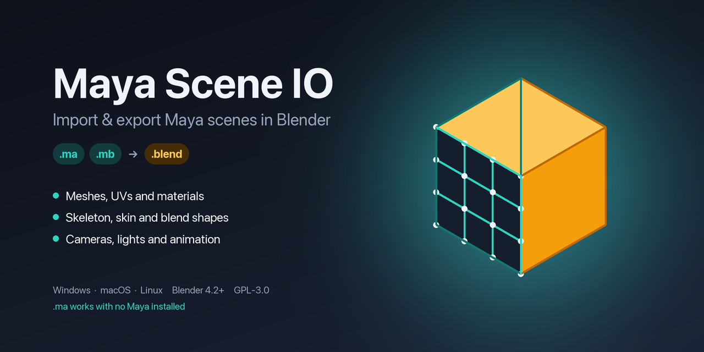

# Maya Scene IO

<p align="center">
  
</p>


A Blender add-on for moving Maya scenes into Blender, and back out again. It
reads and writes Maya ASCII (`.ma`) and reads Maya Binary (`.mb`) with no Maya
installed. For anything the native reader can't handle, it can drive a local
Maya install instead.

Which way you bring a file in depends on whether you have Maya installed, so
there are two engines and you pick one per import.

## Two engines

Reading *any* Maya file without Maya is not possible. Files can reference
plugin nodes (Arnold, custom rigs, and so on) that no outside tool can decode,
and some meshes exist only as construction history that Maya evaluates on load.
So the add-on gives you a choice.

**Native** parses `.ma` and `.mb` directly in Python. No Maya, works offline,
fast, and reads files from old Maya versions too. It handles the standard data
(meshes, UVs, the joint skeleton, skin weights, blend shapes, and
lambert/blinn/phong materials) on most files. It is best effort, so unusual
nodes or exotic materials may come in partially. `.mb` support is newer than
`.ma` support; see Limitations for what it does not read yet.

**Maya bridge** points the add-on at a local `mayapy` and lets Maya export the
scene to FBX, which Blender then imports. Because Maya reads the file, this
works for any version, any plugin, references, and `.mb`. It needs Maya
installed, and it is the same approach the commercial Maya importers use.

`Auto` (the default) uses Native, except that a `.mb` goes through the bridge
when Maya is installed. If the bridge fails, the add-on falls back to Native.

## What comes across

Both engines bring over geometry, UVs, the skeleton at its bind pose, skin
weights, and blend shapes. The native engine also rebuilds materials as
Principled BSDF and wires up PBR textures sitting next to the file.

What does not transfer, by any tool or format, is the Maya control rig's logic:
the FK/IK switches, set-driven keys, and utility-node graph that make controls
drive joints. That lives in Maya's evaluation engine and has no Blender
equivalent. You get a clean, skinned deform skeleton; the animator rig is rebuilt
in Blender. The add-on can generate a basic FK + IK control rig from the file to
get you started.

## Features

Import:

- Meshes: vertices, polygons, all UV sets, vertex colours, edge hardness, per-face materials
- Materials as Principled BSDF with PBR textures auto-wired
- Joint skeleton at bind pose, deform bones split into their own bone collection
- Skin weights as vertex groups plus an Armature modifier
- Blend shapes as shape keys
- Cameras, lights, and time-based animation
- Maya object visibility, sorted into collections
- Optional FK + IK control rig generated from the file

Export:

- Meshes (placed in world space), UVs, normals, vertex colours, per-face materials, visibility
- Skeleton with its hierarchy, skin weights, and blend shapes with their weights

## Install

Works the same on Windows, macOS and Linux. You need Blender 4.2 or newer.

1. Download `maya_scene_importer-x.y.z.zip` from the Releases page. **Do not
   unzip it.** Blender installs the zip as-is.
2. In Blender open `Edit > Preferences > Get Extensions`, click the small
   drop-down arrow (top right), choose `Install from Disk...`, and pick the zip.
3. Confirm **Install and Enable** when Blender prompts. To enable it later, find
   Maya Scene IO under `Edit > Preferences > Get Extensions > Installed`.

If you previously copied the individual `.py` files into Blender's
`scripts/addons` folder, remove those copies and restart Blender. The files
belong together inside the extension ZIP; Blender can mistake loose support
files for separate add-ons and warn that they are missing `bl_info`.

## Using it

Import from `File > Import > Maya Scene`, export from `File > Export > Maya
Scene`. There is also a "Maya IO" tab in the 3D viewport sidebar (press N) with
the same options and one-click buttons.

### Plain `.ma` files

Nothing else to set up. Pick `Native` (or leave it on `Auto`) and import.

### The Maya bridge

The bridge, and `.mb` export, need Maya installed on the same computer. The add-on runs a small program
that ships with Maya called `mayapy` (it is a Python interpreter inside Maya's
`bin` folder). It never opens Maya's window.

The add-on looks for Maya in the usual places and picks the newest version it
finds, so you may not have to do anything. If the sidebar's "Maya Binary (.mb)"
panel says Maya was not found and you want the bridge, set the path yourself in
`Edit > Preferences > Add-ons > Maya Scene IO`. You can pick any of these:

| OS | `mayapy` is usually at |
| --- | --- |
| Windows | `C:\Program Files\Autodesk\Maya2024\bin\mayapy.exe` |
| macOS | `/Applications/Autodesk/maya2024/Maya.app/Contents/bin/mayapy` |
| Linux | `/usr/autodesk/maya2024/bin/mayapy` |

Picking the `bin` folder, or the Maya install folder, works as well. The
`MAYA_LOCATION` environment variable is honoured too.

## Troubleshooting

- **"Maya was not found"**: set the path as described above.
- **"Maya FBX export failed"**: some older Maya versions (2014 and similar) ship
  an FBX plugin that rejects the export. The add-on then converts the file to
  `.ma` with Maya and imports that natively. If that fails too, it reads the
  original file natively. A warning tells you this happened; complex scenes may
  lose features or import slowly. Include the console output
  and a sample scene in a bug report if the result is incorrect.
- **Anything else**: on Windows open `Window > Toggle System Console` in Blender
  (on macOS and Linux start Blender from a terminal), repeat the import, and
  attach the printed text to a [bug report](https://github.com/MenuuTUX/maya-scene-io/issues) together with your
  Maya and Blender versions.

## Limitations

- No Maya means standard files only. Plugin nodes, and meshes stored only as
  construction history (a `polyCube` with no baked geometry, for example), need
  the Maya bridge. Delete history in Maya to bake them. The import warns about
  each mesh it skips for this reason.
- Native `.mb` import is new. It was checked against `.mb` files from Maya
  2014 and 2020, and the older 32-bit format against a Maya 2009 file that has
  no baked mesh. It does not read blend shapes, vertex colours or creases yet.
  Lights, `file` textures and `bump2d` nodes are recognised only when they keep
  Maya's default names (`spotLightShape1`, `file3`); renamed ones come in
  without a type. Writing `.mb` still needs Maya.
- The control-rig logic does not transfer (see above).
- The native parser was developed against Maya 2023. Other versions should be
  fine for geometry and skeletons, since those formats are stable, but please
  open an issue if something breaks.
- Materials beyond lambert/blinn/phong (Arnold aiStandardSurface and friends)
  import as a plain material on the native path. Use the Maya bridge for those.

## Building from source

The add-on lives in `maya_scene_importer/`. Package it with:

```
blender --command extension build --source-dir maya_scene_importer --output-dir dist
```

The full GitHub release adds the Maya bridge and `.mb` export. The official
Blender Extensions edition is built separately without them. It imports `.ma`
and `.mb` and exports `.ma`:

```sh
python scripts/build_native_extension.py --output-dir dist
```

## Layout

```
maya_scene_importer/
  __init__.py        entry point of the full edition
  ui.py              operators, sidebar panel, registration (both editions)
  bridge_ui.py       .mb and Maya bridge operators, preferences (full edition)
  ma_parser.py       Maya ASCII tokeniser and node graph
  mb_parser.py       Maya Binary reader, fills the same node graph
  ma_model.py        turns the node graph into Blender-ready data
  scene_builder.py   builds the Blender scene on import
  ma_exporter.py     writes Maya ASCII on export
  maya_bridge.py     drives mayapy for FBX and .mb export
  rig_builder.py     generates the FK + IK control rig
```

The parser and model layers do not import `bpy`, so the heavy logic can be
tested with a plain Python interpreter.

## Contributing

Bug reports with a sample `.ma` that reproduces the problem are the most useful
thing you can send. See [CONTRIBUTING.md](CONTRIBUTING.md) for how the code is
laid out and how to run the checks.

Using Maya Scene IO? A GitHub star helps other Maya and Blender users find it.

## License

GPL-3.0-or-later. Blender add-ons link against `bpy` and have to be GPL
compatible.
